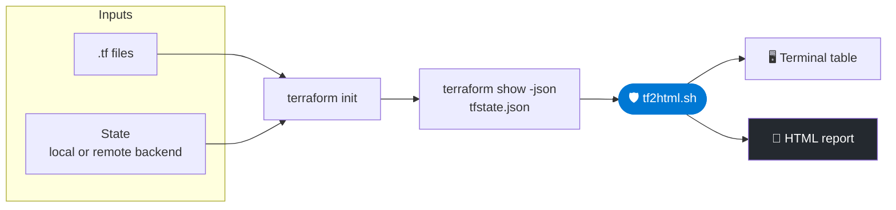

# 🖥️ Running `tf2html.sh` from Another Computer or Terminal

**Generate the Azure resource inventory from any machine that has the Terraform configuration, the state, and backend access**


[What You Need](#-what-you-need) • [Remote Backend](#1️⃣-scenario-a--remote-backend-recommended) • [Local State](#2️⃣-scenario-b--local-state-file) • [Report-Only Host](#3️⃣-scenario-c--report-only-host) • [Safety](#️-safety-checklist) • [Quick Reference](#-quick-reference)

---

Terraform does not depend on a specific computer or terminal. You can generate the inventory from another machine, provided you have the correct Terraform configuration, access to the same state, and the required backend permissions.

`tf2html.sh` reads the output of `terraform show -json`, not a raw `terraform.tfstate`. Generating that output only reads the state. It does not change or destroy any infrastructure.

> [!CAUTION]
> **Do not run `terraform destroy` or `terraform apply`.** They change your Azure resources, and the inventory does not need them.

---

## 📋 What You Need

| # | Requirement | Details |
| --- | --- | --- |
| **1** | **Terraform configuration files** | The same `.tf` files that define the infrastructure, plus `.terraform.lock.hcl` and any variable files |
| **2** | **Terraform state** | Local `terraform.tfstate` or a remote backend |
| **3** | **Backend access** | Read permission on the remote state, if you use one. Access to the Azure resources themselves is not needed |
| **4** | **Tools** | Terraform, Bash, `jq` (`column` is optional) |



---

## 🎯 Choose Your Scenario

| Scenario | State Location | Machine Needs | Best For |
| --- | --- | --- | --- |
| **A** | ☁️ Remote backend | Terraform, `.tf` files, backend access | 👥 Teams, recommended |
| **B** | 💻 Local `terraform.tfstate` | Terraform, `.tf` files, the state file | 🧪 Single-user projects |
| **C** | 📄 Exported `tfstate.json` | Bash and `jq` only | 🖥️ Report-only hosts |

---

## 1️⃣ Scenario A · Remote Backend (Recommended)

If your project uses a remote backend, such as Azure Blob Storage, AWS S3, Google Cloud Storage, or HCP Terraform, the state is stored remotely rather than solely on your computer.

**Step 1 · Copy or clone the project**

Obtain the same Terraform configuration files (`.tf`) and any required variable files.

**Step 2 · Sign in to the backend**

For Azure Blob Storage, run `az login` (or set the `ARM_*` environment variables).

**Step 3 · Initialize Terraform**

```bash
terraform init
```

This initializes the working directory and configures access to the remote backend.

**Step 4 · Verify the target infrastructure**

```bash
terraform workspace show
terraform state list
```

Confirm that you are using the correct workspace and that the expected resources are listed.

**Step 5 · Export the report input**

```bash
terraform show -json > tfstate.json
```

**Step 6 · Run the script**

```bash
./tf2html.sh tfstate.json azure_inventory.html
```

> [!IMPORTANT]
> Ensure the new machine has the necessary backend permissions. Do not run `terraform init -migrate-state` unless you intentionally want to migrate the state.

---

## 2️⃣ Scenario B · Local State File

If Terraform stores its state locally in `terraform.tfstate`, that file must be available on the new machine.

**Step 1 · Copy the project**

Transfer the Terraform configuration files and the correct `terraform.tfstate` file. Include any required variable files and `.terraform.lock.hcl`.

**Step 2 · Initialize Terraform**

```bash
terraform init
```

This initializes the working directory and installs the providers.

**Step 3 · Verify the state**

```bash
terraform state list
```

Confirm that the expected resources appear in the state.

**Step 4 · Export the report input**

```bash
terraform show -json > tfstate.json
```

**Step 5 · Run the script**

```bash
./tf2html.sh tfstate.json azure_inventory.html
```

> [!WARNING]
> Without the correct state file, Terraform does not know which resources it manages, and the report comes out empty. Do not continue until `terraform state list` shows your resources.

---

## 3️⃣ Scenario C · Report-Only Host

If the new machine only needs to run the report and not Terraform, export the JSON where the configuration and state already are, then move only that file.

**Step 1 · On the original machine**

```bash
terraform show -json > tfstate.json
```

**Step 2 · Copy the files to the new machine**

```bash
scp tfstate.json tf2html.sh user@new-host:~/
```

Use `scp` or another encrypted channel, not Git.

**Step 3 · Run the script**

```bash
./tf2html.sh tfstate.json azure_inventory.html
```

> [!TIP]
> This machine only needs Bash and `jq`. No `.tf` files, `terraform init`, or Azure login are needed.

---

## 🛡️ Safety Checklist

Before running the script, verify that:

- [ ] You have the correct Terraform configuration files
- [ ] Terraform is connected to the correct backend and workspace
- [ ] The state contains the expected resources (`terraform state list`)
- [ ] The JSON is the right format (the command below prints `true`)
- [ ] You have backed up the raw `terraform.tfstate` if the state is local
- [ ] State and `show -json` output are kept out of Git and shared folders

```bash
jq 'has("values") and (.values | has("root_module"))' tfstate.json
```

### ✅ Recommended `.gitignore`

```
# Terraform state and exports (may contain secrets)
*.tfstate
*.tfstate.*
tfstate.json

# Generated reports
azure_inventory.html
azure_resources.html

# Terraform working directory
.terraform/
```

> [!IMPORTANT]
> State and `show -json` output can contain secrets in plain text. Copy them with `scp` or an encrypted channel, never by email, chat, or Git.

---

## 🔀 Key Difference: Raw State vs `show -json`

| | `terraform.tfstate` (raw) | `terraform show -json` |
| --- | --- | --- |
| **Read by** | Terraform | `tf2html.sh` |
| **Works with `tf2html.sh`** | ❌ No (empty report) | ✅ Yes |
| **Use for** | `plan`, `apply`, backups | Reports and inventory |

---

## 🎯 Key Takeaway

Changing computers or terminals does not change the infrastructure Terraform manages. The configuration, state, backend, and workspace determine which resources Terraform can report on.

A remote backend is generally safer for collaborative environments because it centralizes state and can provide state locking. With local state, you must securely transfer and preserve the correct state file.

---

## ⚡ Quick Reference

**Scenario A — remote backend**

```bash
az login
terraform init
terraform show -json > tfstate.json
./tf2html.sh tfstate.json azure_inventory.html
```

**Scenario B — local state**

```bash
# project copied with terraform.tfstate
terraform init
terraform show -json > tfstate.json
./tf2html.sh tfstate.json azure_inventory.html
```

**Scenario C — report-only host**

```bash
# on the original machine
terraform show -json > tfstate.json
scp tfstate.json tf2html.sh user@new-host:~/

# on the new host (Bash and jq only)
./tf2html.sh tfstate.json azure_inventory.html
```

---

🔒 Use `terraform show -json`, not raw state · Never destroy to inventory · Keep state out of Git
