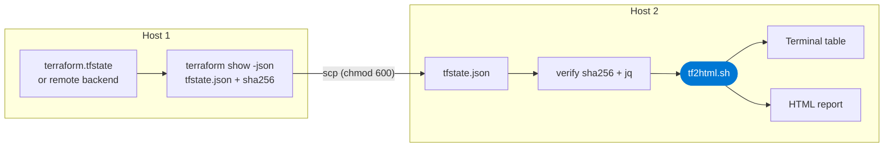

# 🔁 Terraform State Handoff — Host 1 → Host 2 → `tf2html.sh`

**Move the Terraform state from the host that ran `terraform apply` (Host 1) to a new host (Host 2), then generate the Azure resource inventory.**

> [!IMPORTANT]
> `tf2html.sh` does **not** read a raw `terraform.tfstate`. It reads the output of **`terraform show -json`** (it looks under `.values.root_module`). A raw state file or `terraform state pull` output parses without error but produces **zero resources**. Create the input with `terraform show -json` on Host 1, while Terraform and its providers are still available there.

> [!CAUTION]
> Decommissioning **Host 1** (the machine) is not the same as `terraform destroy` (which deletes the Azure resources). Do **not** run `terraform destroy`. Only retire the host, and only after Phase 4 passes.

> [!WARNING]
> If the state is **local** (`terraform.tfstate` on Host 1's disk), destroying Host 1 destroys the only copy. Complete Phases 1–4 first. Without state, resources can only be rebuilt with `terraform import`, one by one.

---

## 📋 Overview

| Phase | Where | Goal |
| --- | --- | --- |
| **1** | Host 1 | Find where the state lives and verify it is healthy |
| **2** | Host 1 | Export `terraform show -json` output, a raw backup, and a checksum |
| **3** | Host 1 → Host 2 | Transfer securely |
| **4** | Host 2 | Verify integrity and contents |
| **5** | Host 2 | Install prerequisites for `tf2html.sh` |
| **6** | Host 2 | Run `tf2html.sh` |
| **7** | Host 1 | Decommission only after everything above passed |



---

## 1️⃣ Host 1 — Locate and verify the state

Run from the root module directory (where the `.tf` files are).

```bash
# Where does state live? A backend block means remote state.
grep -rn -A5 'backend' *.tf

# Local state file present?
ls -la terraform.tfstate terraform.tfstate.backup 2>/dev/null

# Workspaces: state is per workspace
terraform workspace list
terraform workspace show

# Confirm Terraform can read it
terraform version
terraform state list
```

| Finding | Meaning | Path |
| --- | --- | --- |
| `terraform.tfstate` exists, no `backend` block | **Local state** | Phases 2–7 below |
| `backend "azurerm"` (or s3, gcs, etc.) | **Remote state**, not tied to Host 1 | See [Remote backend shortcut](#-remote-backend-shortcut) |

> [!NOTE]
> `terraform state list` must print your resources. If it prints nothing, you are in the wrong directory or workspace.

---

## 2️⃣ Host 1 — Export the report input and a backup

`terraform show -json` renders the current state as JSON with a `values.root_module` tree, which is the structure `tf2html.sh` parses. It needs the module initialised (providers installed), because Terraform loads the provider schemas to render the state.

```bash
mkdir -p ~/handoff && cd ~/handoff

# 1. Report input: the format tf2html.sh reads
terraform -chdir=/path/to/module show -json > tfstate.json

# 2. Disaster-recovery backup: the raw state (keep it, do not feed it to tf2html.sh)
terraform -chdir=/path/to/module state pull > terraform.tfstate.raw
cp /path/to/module/terraform.tfstate.backup ./terraform.tfstate.backup.raw 2>/dev/null

# 3. Lock down permissions and record a checksum
chmod 600 tfstate.json terraform.tfstate.raw
sha256sum tfstate.json | tee tfstate.json.sha256
```

If `terraform show -json` fails with a provider or init error, run `terraform init -input=false` in the module directory and retry.

Quick sanity check on the export:

```bash
# Must print a version, then a number greater than 0
jq -r '.terraform_version' tfstate.json
jq '[.values.root_module | .. | objects | select(has("resources")) | .resources[]
      | select(.mode=="managed")] | length' tfstate.json

# Resource types present
jq -r '.values.root_module | .. | objects | select(has("resources")) | .resources[]
        | select(.mode=="managed") | .type' tfstate.json | sort | uniq -c | sort -rn
```

> [!NOTE]
> Keep the raw backup (`terraform.tfstate.raw`) until you are certain you no longer need to manage this infrastructure. It is the only file that can be used with `terraform apply`, `plan`, or a backend migration. The `show -json` output is a read-only rendering and cannot replace it.

---

## 3️⃣ Host 1 → Host 2 — Transfer securely

State often contains secrets in plain text (keys, passwords, connection strings), and `show -json` output can include them too. Use an encrypted channel and keep the permissions tight.

```bash
# Create the destination directory on Host 2
ssh user@host2 'mkdir -p ~/tf2html && chmod 700 ~/tf2html'

# Copy the report input, checksum, and the script
scp tfstate.json tfstate.json.sha256 user@host2:~/tf2html/
scp /path/to/tf2html.sh                user@host2:~/tf2html/
```

If there is no direct SSH path, encrypt the file for transit through a file share:

```bash
# Host 1
gpg --symmetric --cipher-algo AES256 tfstate.json        # produces tfstate.json.gpg

# Host 2
gpg --decrypt tfstate.json.gpg > tfstate.json
```

> [!CAUTION]
> Do not email the file, paste it in chat, or commit it to Git.

---

## 4️⃣ Host 2 — Verify integrity and contents

```bash
cd ~/tf2html
chmod 600 tfstate.json

# Integrity: must print "tfstate.json: OK"
sha256sum -c tfstate.json.sha256

# Valid JSON
jq . tfstate.json > /dev/null && echo "valid JSON"

# Correct format: must print "true"
jq 'has("values") and (.values | has("root_module"))' tfstate.json

# Azure resources present (same filter tf2html.sh uses): must be greater than 0
jq '[.values.root_module | .. | objects | select(has("resources")) | .resources[]
      | select(.mode=="managed" and (.type | test("^(azurerm|azuread)_|^azapi_resource$")))] | length' tfstate.json
```

| Check | Expected |
| --- | --- |
| `sha256sum -c` | `OK` |
| `jq .` parse | `valid JSON` |
| Format check | `true` |
| Azure resource count | Greater than 0, and equal to the count on Host 1 |

> [!WARNING]
> If the format check prints `false` or `null`, the file is raw state (or `state pull` output), not `show -json` output. The script would report nothing. Regenerate it on Host 1 with `terraform show -json`.

---

## 5️⃣ Host 2 — Install prerequisites for `tf2html.sh`

With a `show -json` file, Terraform and Azure credentials are **not** required.

| Dependency | Required | Check | Install |
| --- | --- | --- | --- |
| **Bash** | ✅ | `bash --version` | Preinstalled on most Linux/macOS |
| **jq** | ✅ | `jq --version` | `sudo apt install jq` · `sudo dnf install jq` · `brew install jq` |
| **column** | ➕ Optional | `which column` | `sudo apt install bsdextrautils` (or `util-linux`) · preinstalled on macOS |
| **Terraform** | ❌ Not needed here | | Only when running `./tf2html.sh` with no arguments |

```bash
chmod +x tf2html.sh
```

---

## 6️⃣ Host 2 — Run the script

```bash
./tf2html.sh tfstate.json azure_inventory.html
```

With no second argument the report is written to `azure_resources.html`. Open it in a browser, or copy it back with `scp`.

---

## 7️⃣ Host 1 — Decommission (last step)

Checklist before retiring Host 1:

- [ ] `sha256sum -c` passed on Host 2
- [ ] Format check printed `true` and the resource count matches Host 1
- [ ] `tf2html.sh` produced the expected report on Host 2
- [ ] Raw backup (`terraform.tfstate.raw`) stored encrypted somewhere durable
- [ ] If you will keep managing this infrastructure with Terraform, state is moved to a **remote backend** (below), or the `.tf` files, `.terraform.lock.hcl`, and raw state are copied to Host 2

> [!WARNING]
> If Host 2 will run future `terraform plan/apply`, the `show -json` file is not enough. Also copy the `.tf` files, `.terraform.lock.hcl`, and the raw state, or better, migrate the state to a remote backend so it no longer depends on any single host.

---

## 🌐 Remote backend shortcut

If Host 1 used a remote backend (for example `azurerm`), the state is not on Host 1 at all. Host 2 only needs to read it.

```bash
# Host 2: needs Terraform, the .tf files (backend block), and Azure auth
az login        # or set ARM_CLIENT_ID / ARM_CLIENT_SECRET / ARM_TENANT_ID / ARM_SUBSCRIPTION_ID

terraform init
terraform workspace select <workspace>      # if you use workspaces
terraform state list                        # must list your resources

./tf2html.sh                                # runs terraform show -json itself, or:
terraform show -json > tfstate.json && ./tf2html.sh tfstate.json
```

Required access: read on the state blob (for example Storage Blob Data Reader on the container, or a storage key) and network reach to the provider registry and storage endpoint. No access to the Azure resources themselves is needed.

---

## ⚡ Command Summary

```bash
# HOST 1
terraform state list
terraform show -json > tfstate.json                    # report input
terraform state pull > terraform.tfstate.raw           # backup
chmod 600 tfstate.json terraform.tfstate.raw
sha256sum tfstate.json | tee tfstate.json.sha256
scp tfstate.json tfstate.json.sha256 tf2html.sh user@host2:~/tf2html/

# HOST 2
cd ~/tf2html
sha256sum -c tfstate.json.sha256
jq 'has("values") and (.values | has("root_module"))' tfstate.json   # must print true
chmod +x tf2html.sh
./tf2html.sh tfstate.json azure_inventory.html
```

---

🔒 Treat state as sensitive · Verify before you destroy · Keep the raw backup · Prefer a remote backend for ongoing work
