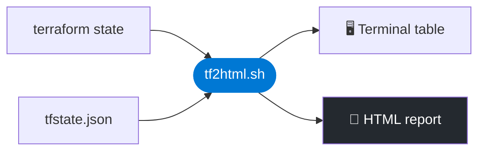

# 📦 Azure Terraform Resource Inventory

**Generate an Azure resource inventory from Terraform state — as a terminal table and a formatted HTML report**


[Overview](#-overview) • [Usage](#-usage) • [Features](#-features) • [Report Output](#-report-output) • [Requirements](#-requirements) • [Limitations](#-limitations) • [FortiCNAPP Integration](#-forticnapp-integration) • [Quick Reference](#-quick-reference)

---

## 📋 Overview

`tf2html.sh` reads Terraform state, extracts the managed Azure resources, and presents them in two formats.

| # | Output | Format | Best For |
| --- | --- | --- | --- |
| **1** | Terminal inventory | Formatted table | 💻 Quick checks in a shell |
| **2** | HTML report | Summary cards + responsive table | 📄 Sharing and review |



> [!NOTE]
> Input is either exported live from Terraform or read from an existing state file. Terraform is only needed for the export path.

---

## 🚀 Usage

### 1️⃣ Export state and generate the report

```bash
./tf2html.sh
```

### 2️⃣ Use an existing state file

```bash
./tf2html.sh tfstate.json
```

### 3️⃣ Set input and output files

```bash
./tf2html.sh tfstate.json azure_inventory.html
```

| Scenario | Command | Terraform Needed |
| --- | --- | --- |
| Export state, then report | `./tf2html.sh` | ✅ Yes |
| Report from existing state | `./tf2html.sh tfstate.json` | ❌ No |
| Custom input and output | `./tf2html.sh tfstate.json azure_inventory.html` | ❌ No |

---

## ✨ Features

- 🔎 **State extraction**: pulls managed Azure resources from Terraform state
- 🏷️ **Readable categories**: maps Terraform resource types to human-readable Azure resource categories
- 🧭 **Key attributes**: resource name, resource group, region, and scope
- 🖥️ **Terminal inventory**: formatted table printed on every run
- 📊 **HTML report**: summary cards and a responsive resource table
- 🌗 **Light and dark modes**: display adapts to the viewer's preference

---

## 📄 Report Output

| Column | Description |
| --- | --- |
| **Category** | Human-readable Azure resource category mapped from the Terraform resource type |
| **Name** | Resource name |
| **Resource Group** | Azure resource group |
| **Region** | Azure region |
| **Scope** | Resource scope |

---

## 🧰 Requirements

| Dependency | Needed For | Required |
| --- | --- | --- |
| **Bash** | Running the script | ✅ Yes |
| **jq** | Parsing Terraform state JSON | ✅ Yes |
| **Terraform** | Exporting state | ⚠️ Only when exporting state |
| **column** | Terminal table formatting | ➕ Optional |

---

## ⚠️ Limitations

> [!WARNING]
> The report reflects the supplied Terraform state only.

- Reports only resources present in the supplied Terraform state
- Does not discover resources directly from Azure
- Does not calculate FortiCNAPP workload quantities
- Resource classifications and summary statistics may require additional mappings and validation

---

## 🛡️ FortiCNAPP Integration

The inventory gives a Terraform-managed view of an Azure environment, which is a useful starting point when scoping a FortiCNAPP integration.

| Covered by this report | Not covered |
| --- | --- |
| Terraform-managed Azure resources | Resources created outside Terraform |
| Resource category, group, region, scope | FortiCNAPP workload quantities |

> [!IMPORTANT]
> Validate classifications and totals against the live Azure environment before using them for FortiCNAPP scoping.

---

## ⚡ Quick Reference

```bash
# Export state and generate the report
./tf2html.sh

# From an existing state file
./tf2html.sh tfstate.json

# Custom input and output
./tf2html.sh tfstate.json azure_inventory.html
```

> [!CAUTION]
> Terraform state can contain sensitive values. Treat `tfstate.json` and generated reports as sensitive, and keep them out of Git:
>
> ```
> *.tfstate
> *.tfstate.*
> tfstate.json
> ```

---

🔒 Treat state as sensitive · Validate before scoping · Re-run after every apply
